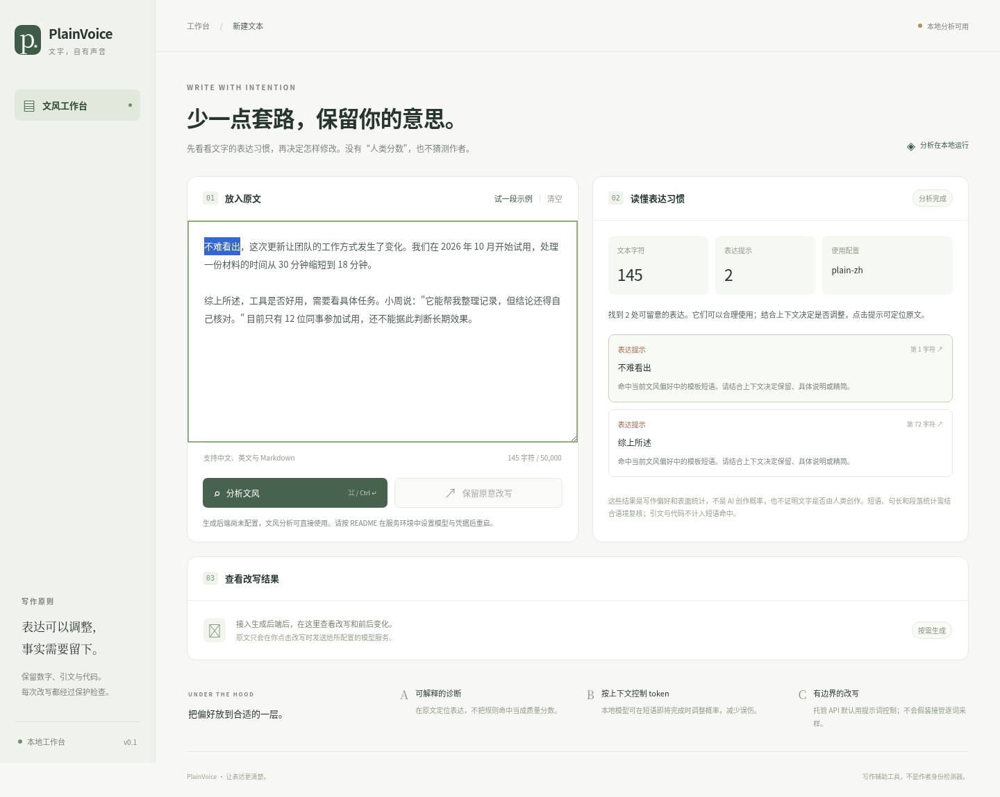

# PlainVoice

[English](README.en.md)

中文写作诊断与生成时文风控制工具。它把“读起来更自然”拆成可检查的表达偏好：先定位文本中的具体问题；在能够访问 logits 的模型上，再按短语上下文调整下一个 token 的概率。

**“人类词加分、AI 词减分”可以作为可训练的偏好，但不能当成通用词典。** 同一个词在不同题材中的作用不同，中文的一个词也常被切成多个 token。PlainVoice 因而提供有界的短语控制和自有语料校准，不输出“AI 写作概率”，也不承诺通过任何检测器。



实际界面：离线分析，无模型凭证时禁用改写。

## 可以做什么

- **离线诊断**：输出命中的原文、位置与解释，代码和引用受到保护；不需要模型或 API 密钥。
- **生成时控制**：本地 Hugging Face logits processor 只在匹配到短语前缀后调整完成该短语的 token，避免全局压低共享汉字。
- **语料学习**：从同题材的参考文本与模型文本估计平滑后的 token 频率偏好，记录 tokenizer 信息并限制权重；正向增强需要显式开启。
- **改写工作台**：浏览器中诊断、调用配置好的生成后端、比较前后文本；对数字、引用、代码等执行确定性保留检查。
- **可复用接口**：Python 包、命令行、JSON 配置与 Agent Skill 接口。

这些是工程能力，不等于已经证明“更像人写的”。目前没有附带可支持这种结论的公开盲评语料或真实模型效果报告。测试与效果评估的边界见 [评估方案](docs/evaluation.md)。

## 五分钟开始

需要 Python 3.11 或更新版本。推荐使用 [uv](https://docs.astral.sh/uv/) 按仓库中的 `uv.lock` 安装固定版本的开发依赖。以下命令在仓库根目录运行：

```bash
uv sync --frozen --extra dev --extra tokens
source .venv/bin/activate

plainvoice analyze examples/input.txt --profile examples/profile.json
plainvoice analyze examples/input.txt --profile examples/profile.json --json
plainvoice serve --host 127.0.0.1 --port 8765
```

示例原文配合示例配置会展示两处可复核的命中。不使用 `--profile` 时采用内置偏好，命中数可能不同；零命中也不意味着文本没有写作问题。

没有 uv 时也可用 `python -m venv .venv` 创建环境，激活后运行 `python -m pip install -e '.[dev,tokens]'`。该方式按版本范围解析依赖，不保证与锁文件完全一致。

工作台默认只绑定本机。未配置生成后端时，仍可使用完整的离线诊断；界面会明确提示改写功能不可用，不会用预制结果冒充模型输出。

```bash
pytest
ruff check .
```

### 调用兼容 OpenAI 的接口

通过环境变量配置后端，不要把密钥写入代码、配置样例或提交记录。云环境中请在环境设置中安全提供密钥。

```bash
export PLAINVOICE_MODEL='your-model-name'
export PLAINVOICE_BASE_URL='https://api.openai.com/v1'
# PLAINVOICE_API_KEY 由你的密钥管理方式注入。

plainvoice rewrite examples/input.txt --backend openai
```

默认远程模式通过写作指令约束文风。**它不会声称正在控制远程模型的短语级 logits。** 云端接口是否支持静态 `logit_bias`，取决于具体模型和服务商；静态 token 偏置也无法表达依赖前文的多 token 短语规则。

输出经过保留检查才会交付。检查失败时命令返回错误，不把失败的改写当作成功结果。检查能够发现部分事实变化，不能证明所有语义都没有变化，发布前仍需审阅。

### 使用本地模型控制生成

本地推理需要可选依赖，以及你已经准备好的兼容因果语言模型。此路径只读取本地缓存或模型目录，不在首次运行时自动下载大模型：

```bash
uv sync --frozen --extra dev --extra tokens --extra local
plainvoice rewrite examples/input.txt --backend local --model /path/to/cached-model
```

本地模式使用模型自己的 tokenizer 编译短语规则，并在生成时应用 logits processor。目前适配器使用 CPU，要求模型提供聊天模板，单次最多生成 1,024 个新 token；大模型可能很慢或超出内存。当前工程测试验证了处理器逻辑；未配置真实模型的环境没有完成本地模型端到端效果验证，不能据此声称某个模型的文风已改善。

### 自定义文风配置

[examples/profile.json](examples/profile.json) 是可编辑的最小例子：

```json
{
  "schema_version": 1,
  "name": "plain-zh-example",
  "description": "减少重复使用的篇章提示语，不禁止正常表达。",
  "max_bias": 1.5,
  "rules": [
    {"text": "需要特别说明的是", "bias": -0.8},
    {"text": "从另一个层面来看", "bias": -0.6}
  ]
}
```

`bias` 表示加到 logits 上的值，不是概率百分点。负值降低相应候选的相对概率，正值提高它；任何权重都受上限约束。诊断中的命中只是一个审阅提示，正常表达也可能命中。

```bash
plainvoice analyze examples/input.txt --profile examples/profile.json --json
plainvoice compile --profile examples/profile.json --tokenizer cl100k_base --out phrase-plan.json
```

编译计划携带 tokenizer 标识。它供兼容的本地解码器使用，不能直接作为远程接口的 `logit_bias` 字段发送。token ID 也不能跨 tokenizer 复用。

首次加载部分 tiktoken 编码时会从 `openaipublic.blob.core.windows.net` 下载词表。在限制网络的环境中，需要将该域名加入环境设置并应用配置后再运行 `compile` 或 `fit`；仅保存配置草稿不会立即改变当前网络。离线诊断不依赖这个下载，已有有效 tokenizer 缓存时也不需要重复下载。

`compile` 和 `fit` 的输出文件必须尚不存在，避免覆盖你已经保存的实验结果。再次运行时请换一个文件名。

正权重配置需要显式加 `--allow-positive` 编译或运行，避免无意增强带来的重复。

### 从自己的语料学习

准备两组 UTF-8 文本：参考文风语料，以及同题材、同事实约束下的模型语料。不要把不同体裁、长度或主题造成的词频差异当成文风差异。

```bash
plainvoice fit \
  --human data/reference \
  --model-corpus data/generated \
  --tokenizer cl100k_base \
  --out token-bias.json
```

默认只学习负向偏好。训练结果是特定语料与 tokenizer 的统计产物，不是“人类词表”。训练和评估必须分开；请仅使用你有权处理的文本。算法、使用边界与本地解码器接口见 [设计说明](docs/design.md)。

生成时可通过 `--bias-table token-bias.json` 选择语料表。本地模式会校验表与模型 tokenizer 是否一致，不能把本例的 `cl100k_base` 表用于另一个 tokenizer。远程静态偏置还需要 `--tokenizer-id cl100k_base` 与 `--allow-static-bias`；前者必须与表中标识完全一致，后者表示你已确认该服务支持静态偏置及其 tokenizer。工具无法替服务商验证这个能力声明，请先用小样本实际验证。

## 与原项目的关系

本项目的起点是对 [lieflat-less-ai-tone](https://github.com/larashero3-dotcom/lieflat-less-ai-tone) 的观察：它通过规则检测、会话中的语义复核与 Skill 指导改写控制文风。PlainVoice 独立实现了可编程的诊断、生成适配与 token 控制层。

原项目采用 **CC BY-NC 4.0**。本仓库没有复制其脚本、研究语料、规则表或报告模板，也没有将其研究数值作为本项目已验证的结果。这里的独立代码采用 [MIT](LICENSE) 许可；如需使用原项目的材料，应另行遵守其许可。

## 项目边界

- 提高某些 token 的概率，可能增加重复、改变语气或事实，需要同时检查内容质量。
- 代码、引用、数字等的保留检查只是确定性检查，不能代替语义审阅。
- 本地 logits 控制需要能实际访问生成过程的模型；安装 Skill 本身不能赋予一个托管模型这种权限。
- 默认规则是可修改的产品偏好，不是经过独立复现的作者身份特征。

[架构与算法](docs/design.md) · [评估与发布标准](docs/evaluation.md) · [Agent Skill](SKILL.md)
